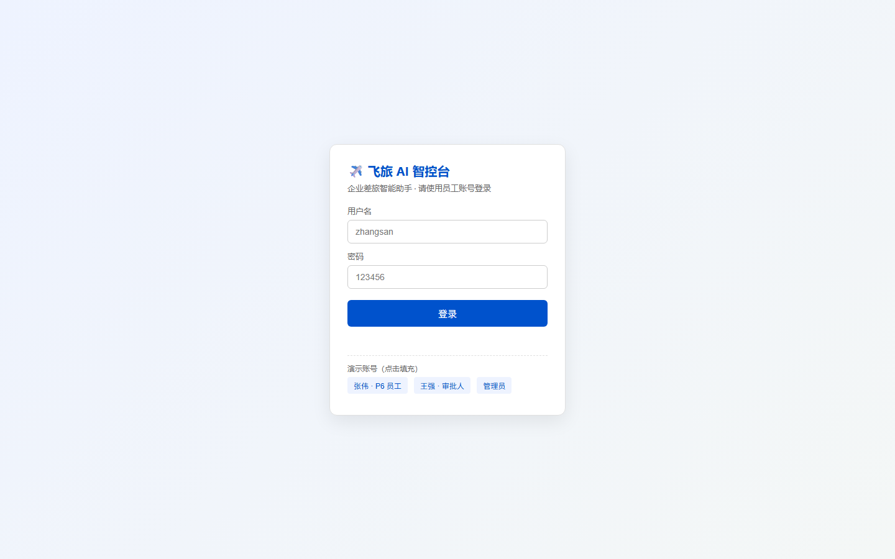
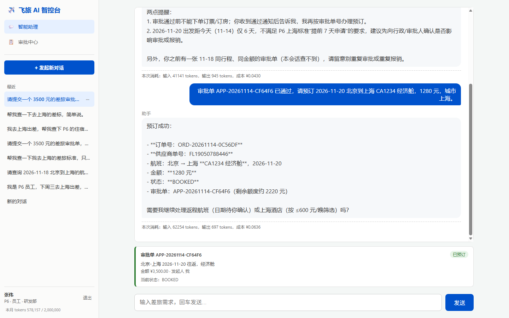

# 企业智能差旅 Agent 平台

[](https://github.com/ycy175/travel-agent/actions/workflows/ci.yml)

> **一句话**：员工用自然语言说出差旅需求，Agent 查差标、起草审批单；**人审批通过后 Agent 才能下单**。
>
> **核心设计原则**：LLM 只负责"表达与规划"，身份、权限、金额、状态、幂等全部由服务端校验。
> 模型可以被提示词影响，但绕不过业务规则。

[1. 项目速览](#1-项目速览) · [2. 问题与原则](#2-问题与原则) · [3. 亮点与解法](#3-亮点与解法面试主战场) · [4. 架构与链路](#4-架构与链路) · [5. 技术选型取舍](#5-技术选型取舍) · [6. 快速开始](#6-快速开始) · [7. 测试与质量](#7-测试与质量) · [8. 已知限制](#8-已知限制与演进方向) · [9. 附录](#9-附录)

---

## 1. 项目速览

一个可本地一键启动的企业差旅智能助手，覆盖「自然语言提需求 → 查差标 → 人工审批 → 合规下单 → 全程审计」完整闭环。

- **技术栈**：Spring Boot 4.1 · Java 17 · AgentScope 2.0（Harness + ReAct）· DeepSeek（OpenAI 兼容）· H2 · MCP 子进程 · SSE 流式对话
- **规模**：8 张数据表 · 23 个自动化测试 · 5 个业务工具 + 1 个 MCP 工具 · 12 个按依赖拆分的提交
- **分层**：`sse` `auth` `chat` `approval` `policy` `order` `tools` `audit` `usage` `ratelimit` `idempotency` `mcp`
- **工程化**：GitHub Actions CI 全绿（见顶部徽章）· Docker / Compose 一键部署 · 演示账号开箱即用

界面预览：

| 登录页 | 对话与审批 |
|---|---|
|  |  |

---

## 2. 问题与原则

企业差旅场景里，直接让大模型"帮忙订票"有四个真实风险：

1. **越权**：模型可能自己编造职级、冒充他人提交审批；
2. **绕过审批**：模型可能声称"已批准"就直接调下单工具；
3. **重复执行**：网络重试或用户重复点击导致重复审批、重复下单、重复扣款；
4. **不可追溯 / 成本失控**：出了问题查不到谁在什么时间做了什么，Token 用量也无上限。

本项目的回答是一个贯穿全局的原则：**把 LLM 当作不可信的输入源**。它只能提供业务参数，身份从会话注入、金额与状态由服务端判定、每次写操作都留审计。这不是靠提示词"请遵守规则"，而是靠代码让违规在物理上不可能。

---

## 3. 亮点与解法（面试主战场）

### 3.1 模型不可信 → 身份从上下文注入，Schema 层就堵死越权

工具方法签名里的身份参数是 `RuntimeContext`（框架注入），不是模型可填的字段。为避免"框架反射时把它泄漏进 JSON Schema"，专门写了 `ToolSchemaTest`：断言 `submit_travel_approval` 的 schema 只有 `itinerary` / `cost`，`query_travel_policy` 只有 `city`——一旦泄漏，测试直接失败。

- **效果**：模型无法伪造 `userId`、`level`，查询差标按登录员工职级，查询审批单按会话 + 用户过滤。
- **配套**：HMAC Token（12h）统一拦截 `/api/**`，PBKDF2WithHmacSHA256（12 万次迭代 + 随机盐）存密码。

### 3.2 审批不可绕过 → 状态机 + 乐观锁 + 下单前二次校验

审批单用 `PENDING → APPROVED/REJECTED → BOOKED` 状态机约束，`version` 乐观锁防并发重复审批。规则上：≤5000 元本人可确认，超过必须同部门审批人或管理员，**禁止自己批自己**。

关键在于**下单不信任 Agent 的话**：`OrderService.book()` 自己重新查审批单状态（必须 `APPROVED/BOOKED`）、重新校验差标、重新核对订单金额不超过审批金额、重新验证归属。Agent 即使被诱导说"审批过了"，服务端仍然会拒绝。

### 3.3 重复提交 → 双层幂等

- **审批层**：`userId | sessionId | 行程 | 金额` 的 MD5 作为幂等键，`idempotency_record` 表用主键冲突做原子锁，重复调用返回同一结果；
- **订单层**：`(approval_id, type)` 数据库唯一索引兜底，并发插入捕获 `DuplicateKeyException` 后返回已有订单；
- **失败可恢复**：供应商调用失败留 `FAILED` 订单，允许重试，成功/失败都写审计。

### 3.4 成本与滥用 → 预算 + 限流 + 实时计价

每用户每月 200 万 Token 预算，对话前 `ensureWithinQuota` 拦截；对话 10 次/分钟/用户、登录 5 次/分钟/IP（进程内令牌桶）。SSE 事件中按事件类型提取 usage，按配置化单价实时计算成本并随消息落库，`/api/usage` 可查本月用量。

### 3.5 可追溯 → 全链路审计

登录、工具调用（参数 + 结果 + 耗时）、审批、下单、对话用量全部写 `audit_log`，成功失败都留痕。管理员可查全量，员工只能查自己的。

---

## 4. 架构与链路

```
Browser (index.html)
   │  SSE / REST + HMAC Token
   ▼
AuthInterceptor ── RateLimitInterceptor ── ChatController
   │                                        │
   │                                        ├─ AgentScope HarnessAgent（工具调用 / 计划模式 / 上下文压缩）
   │                                        └─ 会话与消息落库
   ▼
ApprovalService ── PolicyService ── OrderService ── SupplierGateway（Mock 机票/酒店）
   │                 │                │
   └── 审批状态机     └── 差标规则库    └── 订单 + 唯一索引幂等
   ▼
AuditService（审计）  UsageService（Token 预算）
   ▼
H2（可替换 MySQL/PostgreSQL）
```

**一次完整对话的链路**：

1. 用户："帮我订下周三北京到上海的机票，3500 以内"
2. Agent 调 `query_travel_policy` → 按登录员工职级 + 城市查差标
3. Agent 调 `submit_travel_approval` → 生成 `PENDING` 审批单（幂等，重复调用返回同一单）
4. 前端展示审批卡片；本人可确认 ≤5000 元的单，超过需**同部门审批人/管理员**
5. 审批通过后前端自动续跑，Agent 调 `book_travel`
6. `OrderService` 校验：审批状态必须 `APPROVED/BOOKED`、差标合规、同审批单同类型只能一单，累计金额不超过审批金额
7. 调用 Mock 供应商 → 订单 `BOOKED`，审批单联动 `BOOKED`
8. 全过程写审计；对话 Token 计入月度预算

---

## 5. 技术选型取舍

| 决策 | 选了什么 / 放弃了什么 | 为什么 |
|---|---|---|
| Agent 编排 | AgentScope Harness（计划模式 + 上下文压缩 + 工具权限），非裸 ReAct 循环 | 多轮工具调用可控，30 条消息触发压缩，避免长对话爆上下文 |
| 认证 | 手写 HMAC Token + PBKDF2，未引入 Spring Security | 依赖面最小、够用；代价是无撤销/刷新，见第 8 节 |
| 数据库 | H2 文件库，零安装可演示 | 生产换 PostgreSQL/MySQL 无需改业务代码（驱动已预留），当前无外部依赖 |
| MCP 集成 | 独立子进程 + 镜像采用 `classes + libs/*` 展开布局 | fat jar 下 `java.class.path` 只有 `app.jar`，子进程加载不到 `FlightMcpServer`，`search_flights` 会失效 |
| 流式协议 | SSE，非 WebSocket | 只需服务端单向推；EventSource 不能自定义请求头，故 token 走 `?token=` |

---

## 6. 快速开始

```bash
export DEEPSEEK_API_KEY=sk-xxx       # Windows PowerShell: $env:DEEPSEEK_API_KEY="sk-xxx"
./mvnw spring-boot:run
# 打开 http://localhost:8080
```

演示账号：

| 账号 | 密码 | 角色 | 部门 |
|---|---|---|---|
| zhangsan | 123456 | EMPLOYEE（P6） | 研发部 |
| lisi | 123456 | EMPLOYEE（M3） | 市场部 |
| wangwu | 123456 | APPROVER（M3） | 研发部 |
| admin | admin123 | ADMIN | 信息中心 |

推荐演示路径：

1. `zhangsan` 登录 → "查一下去上海的差标" → 返回 600 元/晚（城市专项优先于默认规则）
2. 提交 3500 元审批 → 审批卡片点"通过"（≤5000 本人可确认）→ 自动续跑
3. 让 Agent 订机票 1280 元 → 订单 `BOOKED`，审批单变 `BOOKED`
4. 再订 1500 元/晚的酒店 → 被差标拦截
5. `admin` 登录 → 审计日志看到 LOGIN / TOOL_CALL / APPROVAL_APPROVE / ORDER_BOOK / CHAT

Docker 部署：

```bash
export DEEPSEEK_API_KEY=sk-xxx
docker compose up --build -d
# 打开 http://localhost:8080
```

- 数据库文件持久化在 `travel-data` 卷（容器内 `/app/data`）
- Agent 工作区持久化在 `agent-workspace` 卷（`/app/.agentscope`）
- `TRAVEL_TOKEN_SECRET` 未设置时用开发默认值，生产必须覆盖
- 停止：`docker compose down`；连数据卷一起清理：`docker compose down -v`

---

## 7. 测试与质量

23 个测试，集成测试使用 H2 内存库，不依赖真实模型或外部服务：

| 类别 | 测试类 | 覆盖 |
|---|---|---|
| 业务规则集成 | `PlatformIntegrationTest` | 差标优先级、舱位/酒店均价校验、RBAC 审批权限、重复审批、下单幂等、金额上限、供应商失败留痕、审计、Token 用量 |
| 工具契约 | `ToolSchemaTest` | 防止 `RuntimeContext` 泄漏进工具 Schema 造成越权 |
| 单元测试 | `RateLimiterTest` | 令牌桶容量与按 key 隔离 |
| 启动冒烟 | `TravelAgentApplicationTests` | Spring 上下文加载 |

```bash
./mvnw -B -ntp test
```

`.github/workflows/ci.yml` 在 push / pull request 时执行上述命令，JDK 17 + Maven 缓存，状态见顶部徽章。

---

## 8. 已知限制与演进方向

主动列出边界——每一项都附上"如果继续做，我会怎么改"：

1. **限流是单机令牌桶**，多实例需 Redis + Lua 或网关限流。
2. **下单把外部供应商调用放在事务内**，生产建议本地消息表（Outbox）/ Saga 保证最终一致。
3. **每次对话新建 `HarnessAgent` 并 `synchronized`**，高并发瓶颈，应按会话缓存 Agent 实例。
4. **未接入 AgentScope 原生 `RequireUserConfirmEvent` 的确认回传**，当前用业务审批单承接——这样反而把"确认"落成了可审计的业务事实。
5. **供应商为 Mock**；接真实供应商只需实现 `SupplierGateway` 并在 `SupplierRegistry` 注册。
6. **前端 Token 存 localStorage**，生产建议 HttpOnly Cookie + CSRF 防护。
7. **Dockerfile 尚未纳入 CI 构建验证**，首次构建需联网拉取基础镜像与 Maven 依赖。

---

## 9. 附录

### 9.1 接口

| 方法 | 路径 | 说明 |
|---|---|---|
| POST | `/api/auth/login` | 登录（按 IP 限流） |
| GET | `/api/auth/me` | 当前用户 |
| GET/POST | `/api/sessions` | 会话列表 / 新建 |
| PATCH/DELETE | `/api/sessions/{id}` | 重命名、置顶 / 删除 |
| GET | `/api/sessions/{id}/messages` | 历史消息 |
| GET | `/api/chat/stream` | SSE 对话（`sessionId`、`token`、`message`） |
| GET | `/api/approvals?sessionId=` | 会话内审批单 |
| POST | `/api/approvals/{id}/approve` `/reject` | 审批 |
| GET | `/api/approvals/inbox` | 审批人待办（同部门） |
| GET | `/api/orders?approvalId=` | 审批单对应订单 |
| GET | `/api/orders/mine` | 我的订单 |
| GET | `/api/usage` | 本月 token 用量 |
| GET | `/api/audit` | 全量审计（仅 ADMIN） |
| GET | `/api/audit/mine` | 我的审计 |

### 9.2 数据表

| 表 | 说明 |
|---|---|
| `app_user` | 员工账号、职级、角色、部门 |
| `chat_session` / `chat_message` | 会话与消息（含 token、成本） |
| `travel_approval` | 审批单，`version` 乐观锁 |
| `travel_policy` | 差标规则（职级 × 城市，`*` 为默认） |
| `travel_order` | 订单，`(approval_id, type)` 唯一索引 |
| `audit_log` | 审计日志 |
| `idempotency_record` | 通用幂等记录 |

### 9.3 关键配置（均在 `application.yaml`）

| 配置项 | 默认值 | 说明 |
|---|---|---|
| `app.security.token-secret` | 环境变量 `TRAVEL_TOKEN_SECRET` | 生产必须覆盖 |
| `app.approval.self-approve-limit` | 5000 | 本人确认额度上限 |
| `app.quota.monthly-tokens` | 2000000 | 每用户每月 Token 预算 |
| `app.rate-limit.chat-per-minute` | 10 | 对话限流 |
| `app.rate-limit.login-per-minute` | 5 | 登录限流（按 IP） |
| `agentscope.model.openai.api-key` | 环境变量 `DEEPSEEK_API_KEY` | 模型密钥 |
